# Loadout benchmark — Stage 3.5 baseline

A reproducible snapshot of what the current engine says about melee loadouts, so a later fidelity fix can be
compared against it. This is reporting, not mechanics: every number comes from the production optimizer chain
(`src/realBuild.js`) and the production seeded fight (`src/simulateFight.js`). No formula, constant or item was
invented for it.

| | |
|---|---|
| Engine baseline | `a3dd647` (Stage 3.5 closure) |
| Pinned upstream | `a3eb1605ea1dc391b691fe314377458a7e63e483` |
| Run | 26 loadouts × 3 health pools × durability off/on, 200 seeds per cell |
| Wall time | 247.7 s on the development machine |
| Digest | `63758b10abdee9a705b7aefd6b1768ba56ec132346b19400ad8a320a4e960c43` (the committed `docs/benchmark/results.json`; it needs the game's `SPELLS.STD`, see Determinism below) |

## Headline findings

1. **Two-handed long blades lead at every health pool.** The 2H Dai-katana is first at 8k, 40k and 400k HP
   (5,929 / 5,015 / 4,825 mean DPS), with the 2H Claymore second everywhere.
2. **Weapon speed is worth health.** The Short Blade dual-wield pair improves from 9th at 8k HP to 3rd at 40k and
   400k (the DW Wakizashi: 4,734 DPS at 40k). Two-handers win the opening exchange; fast dual blades win the
   sustained fight. Short-vs-long rank correlation is only **0.873**; medium-vs-long is **0.993**.
3. **The planner chain, not the weapon, is the biggest lever.** For the one-handed Katana (the stage chain runs on each family's best one-handed row) the fight DPS goes
   1,044 (gear only) → 1,482 (Firmament tree) → 3,645 (enchant plan) → 4,674 (imprint): **×4.5** in total. The
   enchant step alone is ×2.46 — larger than the tree and the imprint together.
4. **Material matters less than the plan.** Within one fixed build, Iron → Daedric is +20.0% (Katana) and +16.3%
   (Dai-katana). Steel and Silver are identical, as are Mithril and Adamantium (the game's material ladder).
5. **In a 400k-HP fight, durability decides the outcome, not DPS.** With the game's minted condition pool
   (12,800 for a Daedric weapon) every one of the 26 loadouts breaks before the kill: 1H/2H at 35–54 s, dual wield
   at 57–88 s, the slowest (DW Battle Axe) at 88 s. No supported build kills a 400k foe with durability on.
6. **A worn weapon is a different build.** Starting at 4,000 of 12,800 points, the Dai-katana's first break moves
   from 34.9 s to 15.5 s; at 800 points it breaks at 4.4 s. Mean DPS over the fight falls from 3,579 to 1,706.
7. **The top of the table is stable; the middle is not.** Over four disjoint 50-seed blocks the top two keep their
   ranks; ranks 3–8 shuffle, and block-to-block DPS moves by roughly 2–3%.

## Reproduce

```bash
npm run benchmark                                  # ~4 min; rewrites every artifact below
node tools/benchmark-loadouts.mjs --check          # + determinism, immutability and artifact-agreement checks
node tools/benchmark-loadouts.mjs --charts-only    # redraw charts/tables from the committed results.json
```

`--check` re-runs one cell twice and asserts identical metrics and an unchanged character, then reads the written
files back: the JSON digest must match its payload, the leaderboard chart must contain the leaderboard's rounded
values, the CSV must have one row per cell, and `RESULTS.md` must carry the top value.

The run is deterministic given its inputs: the seed list comes from `pairedFightSeeds(200, 20261117)`, and the script uses
no `Math.random` or clock. A second run with the same inputs writes byte-identical files.

**One input is not in this repository: the game's standard spells.** Cast When Strikes enchants read `SPELLS.STD`
from the Daggerfall install named by `arena2Path` in the launcher config (`src/spells.js` `standardSpells()`). The
committed artifacts were produced with that file present (88 spells). On a machine without it the Cast When Strikes
rows are silently dropped and the run is a different, still deterministic, benchmark: with no launcher config the
digest is `48d0d3814a4c799c41acc8795c639aa9d3b429b808c895b3a543af6889d826d1`. So `--check` and the digest above only
reproduce on a machine that has the game data. The tests that need it are reported as skipped, with that reason,
where it is absent (`test/harness/spellbook.mjs`).

## What is measured

One fight is a seeded sequence of blows from the Stage 3.1 fight tier, with health-dependent terms re-evaluated per
segment (Stage 3.2), Cast When Strikes resolved per blow (Stage 3.5.1) and, when enabled, ordinary wear, the CWS
condition bill and breaks (Stage 3.5.2). The sampler is the project's own; it is **not** an event-level reproduction
of the game's RNG, and no chart here claims that.

New runs inherit `simulateFights`' live percentage carry, reset at the start
of each trial. The checked-in `docs/benchmark/` results were regenerated under
that default (mean DPS moves about +0.7-0.9% on long dual-wield cells). The
optimizer and card ceiling baselines are unchanged.

| Field | Definition |
|---|---|
| **Mean DPS** | Mean of `outputDps` over **all** trials. A trial that did not kill is measured over the time it actually ran, so a break or horizon shows up as a lower rate. |
| **Median DPS** | Median of the same field. |
| **Mean / median TTK** | Time to kill over **kills only** (`null` when nothing killed). Conditional on a kill, therefore biased low when there is censoring. |
| **Kill %** | Share of trials that killed inside 900 s, with a Wilson 95% interval. |
| **Mean damage** | Damage dealt per trial, overkill included (the pool plus the last blow's excess). |
| **Break % / first break** | With durability on: share of trials where a weapon transitioned to 0 condition, and the median first-break time over those trials (`docs/benchmark/durability.csv`). |

Durability off and durability on are separate cells and separate charts. They are never mixed in one ranking.

## Scenario

- **Character** — the `loadout` command's own chain (`realBuildStages`): the level-45 max profile
  (`maxCharacter`), the real Firmament tree for the weapon family, the soul-gem enchant plan and the best eligible
  positive imprint. That is the uncapped-theory configuration the optimizer reports. The only extra input is the
  weapon's condition (below).
- **Target** — `referenceFoe(45, 'tough')`: the ordinary foe `maxRun` uses for uncapped theory. Its health in the
  fight is the scenario pool, not its card health.
- **Health pools** — 8,000 / 40,000 / 400,000. Measured blow counts are 2–4 / 12–24 / 118–259, so the three points
  are a genuinely short exchange, a normal encounter and a sustained fight whose length exceeds the minted condition
  budget. (A 2,000-HP pool was tried first and rejected: every build killed in ~1.04 blows, so the "fight" was a
  single opening hit and the DPS figure was a burst artefact.)
- **Seeds** — 200 per cell, one shared list for every build (`pairedFightSeeds`), so differences are paired rather
  than independent samples.
- **Fight limits** — `maxSeconds: 900`, `maxBlows: 6000`, so a supported kill is observable and a censored trial is
  censored for a modelled reason (`outcomes` in the CSV says which).
- **Comparison options** — `core: 'overhaul'`, `rri: true`, `stacks: 5`, `passiveOn: true`, mirroring `maxRun`.
  `stacks: 5` means Flow is priced at its steady state; ordinary fights have no charge clock (a declared limitation).
- **Condition** — durability cells start from a **fresh, game-minted** weapon: the condition fields are left unset,
  so the vendored `mintCondition` gives 12,800 points for a Daedric weapon (1600 × material multiplier / 4). The
  condition sweep instead declares a **worn** weapon: the same minted maximum with `currentCondition` set to 4,000,
  1,600 or 800 points. Condition is a scenario input, recorded per cell.

## Loadouts

26 melee rows: every Long Blade, Short Blade, Axe and Blunt Weapon template in every legal hold (1H, 2H, DW) from the
optimizer's `realWeaponLoadouts({ modes: ['uncapped'] })`. Each definition in `results.json` records the derivation
(`realBuildStages(template, family, mode, dual)`), the weapon item (template, material, affixes, sockets, CWS rows),
the off-hand item, the Firmament build and stars, the enchant plan's rows, and the imprint.

The optimizer's selected imprint is **Way of the Sword** (a Flow power) for every row; it is applied through the
production what-if path (`imprints`), the same path `analyze(...).with({ imprint })` uses. No spell-power imprint is
used, so the silent-ignore defect D2 from the Stage 3.5 audit cannot affect a ranking here.

**Excluded and why** (recorded in `results.json` → `method.exclusions`):

| Row | Reason |
|---|---|
| Short Bow, Long Bow, Thunderlock (2H Archery) | `simulateFight` refuses bows and guns. |
| Pistolet (1H Archery) | `simulateFight` refuses the pair/gun path. |
| Hand Wraps (Fists) | no fist schedule after a break; `simulateFight` refuses unarmed cadence. |

Relay fights are not benchmarked either: relay CWS is not modelled (D3), and relay durability is refused by design.

## Charts

All charts are standalone SVG in [`docs/charts/`](charts/), drawn from the same objects that write `results.json`.
Each title states the metric and the pool.

| File | What it shows |
|---|---|
| 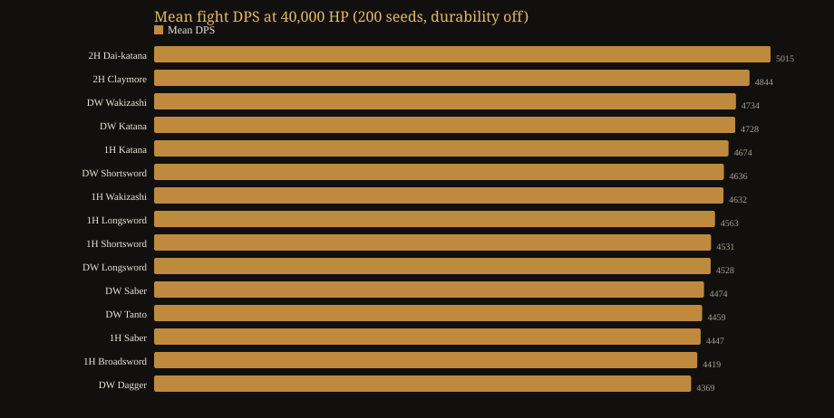 | **[01](charts/01-dps-leaderboard.svg) — DPS leaderboard.** Top 15 by mean fight DPS at 40k HP, durability off. Metric: mean `outputDps` over 200 shared seeds. |
| 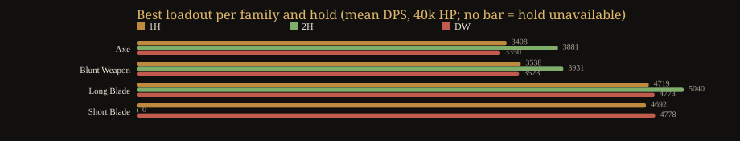 | **[02](charts/02-archetypes.svg) — Archetype comparison.** Best 1H, 2H and DW row per family at 40k HP, same metric. Short Blade has no two-handed weapon, so that bar is absent. |
| 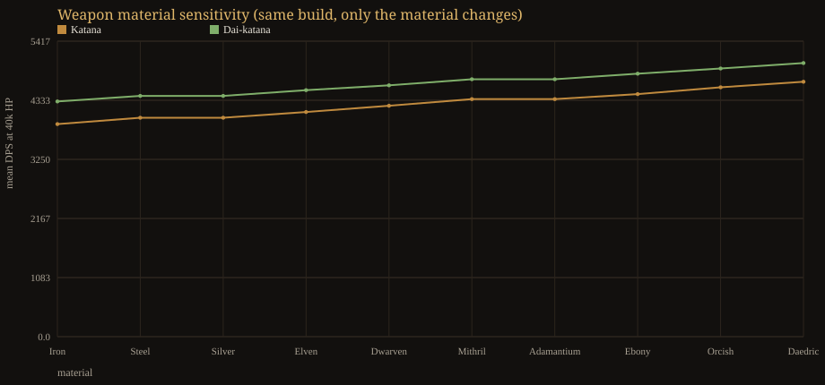 | **[02b](charts/02b-material.svg) — Material sensitivity.** One fixed Katana / Dai-katana build, only the weapon's material changed (the `rank weapons` construction). Metric: mean DPS at 40k HP. |
| 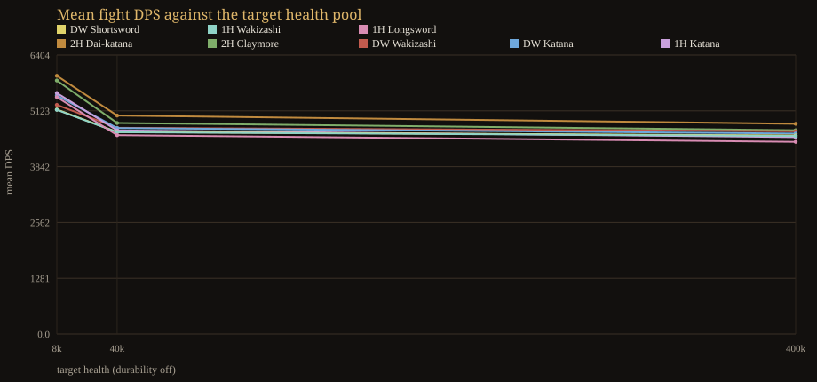 | **[03](charts/03-dps-vs-health.svg) — DPS vs target health.** The top eight by 40k HP across the three pools. Durability off. |
| 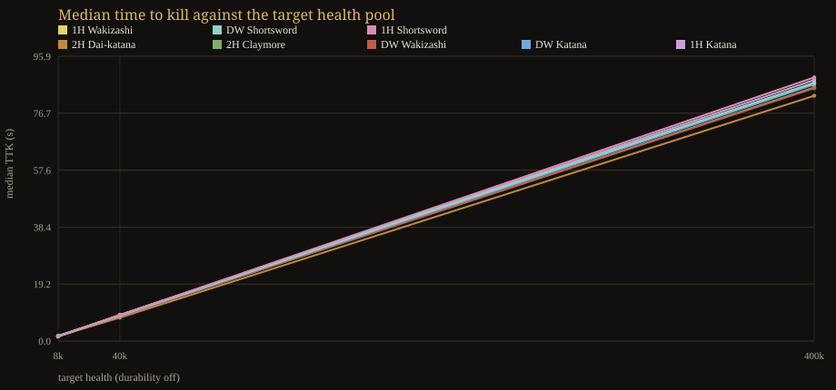 | **[03b](charts/03b-ttk-vs-health.svg) — TTK vs target health.** Median TTK over kills for the same eight. |
| 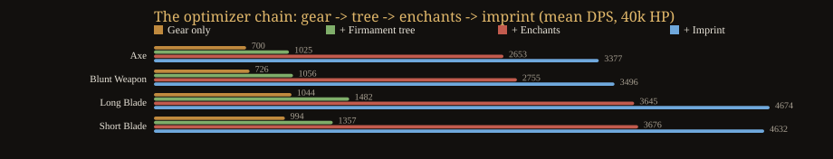 | **[04](charts/04-enchant-contribution.svg) — Enchantment and power contribution.** Each family's best one-handed row staged: gear only → Firmament tree → enchant plan → imprint. Metric: mean DPS at 40k HP. |
| 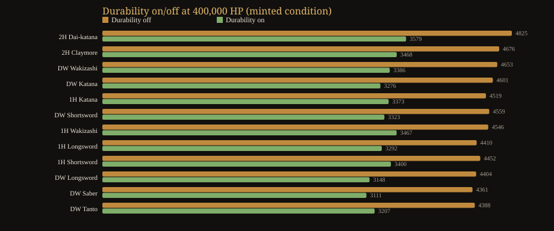 | **[05](charts/05-durability-dps.svg) — Durability impact on DPS.** 400k HP, durability off vs on, top twelve by 40k DPS. Every on-fight is censored by the break, so read this chart with the kill percentages in the table. |
| 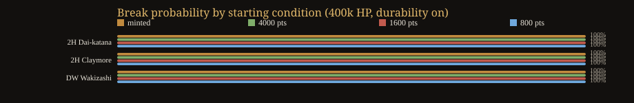 | **[05b](charts/05b-break-probability.svg) — Break probability by starting condition.** Top three builds at 400k HP, starting at the minted pool or a declared 4,000 / 1,600 / 800 points. |
| 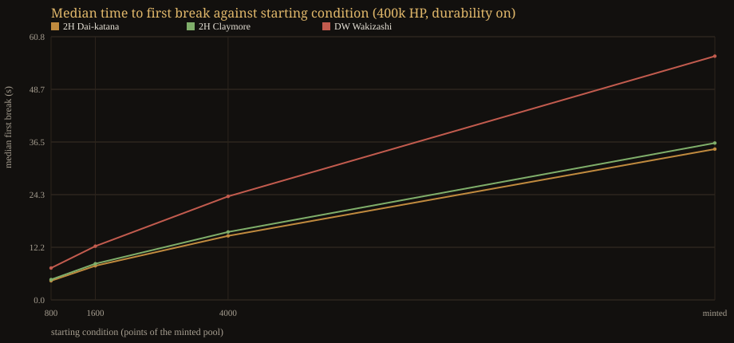 | **[05c](charts/05c-weapon-lifetime.svg) — Weapon lifetime.** Median time to first break against starting condition, same builds. |
| 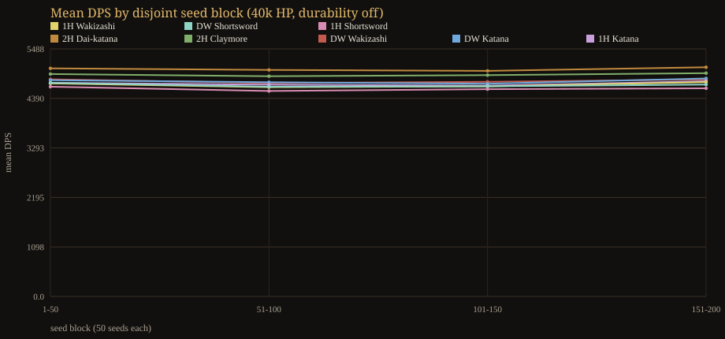 | **[06](charts/06-seed-stability.svg) — Seed stability.** Mean DPS in four disjoint 50-seed blocks for the top eight at 40k HP. |
| 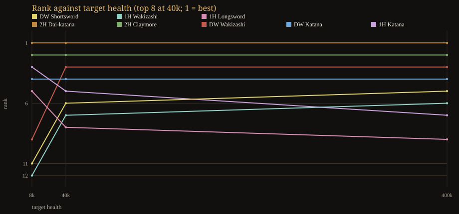 | **[06b](charts/06b-rank-vs-health.svg) — Rank vs target health.** Rank (1 = best) of the top eight across the three pools. |

## Reading the results

**Leaderboard (40k HP, durability off).** 2H Dai-katana 5,015 ± 50 DPS, 2H Claymore 4,844 ± 49, DW Wakizashi
4,734 ± 34, DW Katana 4,728 ± 45, 1H Katana 4,674 ± 43, DW Shortsword 4,636, 1H Wakizashi 4,632, 1H Longsword
4,563. The spread from best to worst (DW Battle Axe, 3,335) is 1.50×. All 78 durability-off cells killed in 100% of
trials, so mean DPS and kill DPS agree and TTK is unconditional.

**Health changes the order.** At 8k HP the order is 2H Dai-katana (5,929), 2H Claymore (5,821), 1H Katana (5,532),
DW Katana (5,475), 1H Longsword (5,438). At 400k the DW Wakizashi and DW Shortsword move to 3rd and 5th. Two-handed
blades keep the per-blow advantage; the dual short blades amortise their faster cadence over more blows. Spearman:
8k vs 400k **0.873**, 40k vs 400k **0.993**.

**The planner chain dominates.** Gear-only builds sit between 700 and 1,050 DPS. The Firmament tree adds ~40% (×1.42 for the
Long Blade, ×1.36–1.47 across families); the enchant plan multiplies by ×2.46–2.71; the imprint adds 26–28%. The
enchant plan's value is skill lines across the set plus Cast When Strikes rows on the weapon — in the fight those rows land as
real casts (the fight's `cwsCasts` are non-zero), not as a card expectation.

**Material is real but secondary.** Iron → Daedric is +20.0% on the Katana and +16.3% on the Dai-katana at fixed
everything else. The ladder's plateaus (Steel = Silver, Mithril = Adamantium) show up as exactly equal columns, which
is the game's material modifier table, not a modelling gap.

**Durability changes the outcome at long horizons.** With a fresh minted weapon at 400k HP, every row breaks before
the kill. Break times: 2H 34.9–48.9 s, 1H 35.7–54.3 s, DW 57.1–88.3 s. Dual wield survives longest because its two
weapons share the wear; the slowest weapon (DW Battle Axe) lasts 88 s. Within a single hand, ordinary wear dominates
the CWS bill at these damage levels: a 2H blow of ~3,600 damage wears ~360 points, while the three CWS rows bill 30.

**A worn weapon compounds two effects.** The condition sweep at 400k HP: the Dai-katana's first break moves
34.9 → 15.5 → 7.9 → 4.4 s as the start drops 12,800 → 4,000 → 1,600 → 800 points, and mean DPS over the fight falls
3,579 → 2,556 → 1,941 → 1,706. The low-condition bands cut damage *and* shorten the fight, so the two cannot be read
as one multiplier.

**What is robust.** The 1–2 order (2H long blades), the planner chain's ordering (enchants > tree > imprint), the
material direction, and the qualitative durability result (long fights break weapons; dual wield lasts longer) are
all stable across seeds and pools. **What is not**: ranks 3–8 at 40k are within 4% of each other and swap between
seed blocks; a re-run with different seeds (not done here) would keep the ordering close but is not claimed exact.

## Limitations and exclusions

These are the engine's declared limits, not benchmark shortcuts:

- **No event-level RNG equivalence.** The fight samples the local fight tier; the game's per-attack `rolls` sequence
  is not reproduced. All comparisons are like-for-like within this engine.
- **Dual-wield pre-break timing** uses the exchange's averaged held burden; the swing in flight at a break uses the
  integer hold from the vendored machine. Drift is a fraction of a tick per earlier off-hand blow
  (the stage record).
- **Flow is a constant five-stack scenario** in ordinary fights; there is no per-blow charge clock (relay fights have
  one, but relays are excluded here).
- **No fist schedule.** A break that leaves no weapon ends the fight (`noWeaponLeft`); it is reported as censoring,
  not as a longer fight.
- **No target shield/armour wear.** Only the attacker's weapon wears.
- **No priced CWS spell-power edits.** Not used here: the selected imprint is a flow power.
- **Audit D1 is avoided, not endorsed.** `equipmentDamageEnhanced` is never enabled; the benchmark does not exercise
  the enhanced wear regime that the engine does not model.
- **Audit D2 is avoided.** What-if spell-power imprints are not used to rank anything.
- **Audit D3 is excluded.** No relay fight is benchmarked, so CWS on a relay weapon never enters a number.
- **Audit D4 is enforced at the harness edge.** `assertScenario` refuses unknown option names and non-boolean
  `durability`; the harness itself passes only the keys it declares.
- **DoTs, other spell families, incoming damage and player death are not modelled.** A fight is the player's output
  against a health pool.

## Files

| Path | Contents |
|---|---|
| `docs/charts/*.svg` | The eleven charts above. |
| `docs/benchmark/results.json` | Everything: method, loadout definitions, 156 cells, leaderboard, ranks, archetype bests, stage chain, material sweep, durability cells and condition sweep, seed blocks, digest. |
| `docs/benchmark/loadouts.csv` | One row per cell (loadout × pool × durability) with every reported metric. |
| `docs/benchmark/durability.csv` | The durability table and the condition sweep. |
| `docs/benchmark/materials.csv`, `docs/benchmark/stages.csv` | The two sensitivity tables. |
| `docs/benchmark/RESULTS.md` | Generated tables (the authoritative numbers; do not edit by hand). |
| `tools/benchmark-loadouts.mjs` | The harness. |
| `test/benchmark.test.js` | Harness contracts: one construction, validated options, condition semantics, determinism, no mutation. |

## Verification record

Run on the benchmark commit's tree, in this order:

| Check | Command | Result |
|---|---|---|
| Full suite | `npm test` | **696 tests, 696 pass, 0 fail**, exit 0 |
| Vendor hash check | `npm run vendor:verify` | ok: **289 vendored, 122 stubbed** @ `a3eb1605ea1dc391b691fe314377458a7e63e483` |
| Vendor parity | `npm run vendor:parity -- --from /tmp/dfo-audit/upstream/src` | **1855 checks, 1855 identical, 0 diverged** |
| Benchmark, first run | `node tools/benchmark-loadouts.mjs --check` | 26 loadouts, 156 cells, 200 seeds/cell, **247.7 s**; digest `012cd593…`; self-check "repeated run identical=true, character unchanged=true"; artifacts digest/chart/csv/md all true |
| Benchmark, second run | the same command again | **256.3 s**; digest `012cd593…` (unchanged) |
| Cross-process determinism | `cmp` of every artifact against a copy of the first run | **`results.json`, all 11 SVGs, all 4 CSVs and `RESULTS.md` byte-identical** |
| No shared-state mutation | in-harness snapshot of each character before/after its fights, plus the twice-run cell | character JSON unchanged in every cell; identical metrics on repeat |
| Optimizer unchanged | `realWeaponLoadouts({ modes: ['uncapped','cap'] })` before and after the `realBuildStages` extraction | **byte-identical** (758,498 bytes) |
| Chart/data agreement | `--check` reads the files back | leaderboard values present in the chart, CSV row count = cell count, `RESULTS.md` carries the top value |

The suite's six new tests (`test/benchmark.test.js`) cover the harness contracts: the benchmark character chain is the
optimizer chain, the melee universe and its refusals, unknown-option rejection, the condition-as-points semantics,
same-seed reproducibility with no mutation, and the rank helper.

Nothing under `vendor/` was modified; no combat formula, constant or option in `src/` changed. The two `src` edits are
reporting-only: `realBuildStages` extracts the existing chain so the benchmark and `realTemplate` share one
construction (output byte-identical), and `lineChart` gained optional `xTicks`/`yTicks`/`invertY` arguments that no
existing caller passes.
